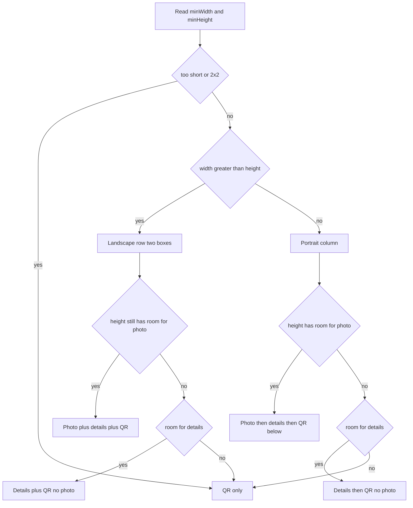

# Responsive business-card widget

## Fix the QR (white dot)

The widget QR is not usable today. [_QrTile](Tap-na/tap_na/lib/core/services/widget_sync_service.dart) uses `CustomPaint` + `QrPainter` **with no `size` and no child**, so the painter has a zero-size canvas. `HomeWidget.renderFlutterWidget` still saves a mostly white square; on the home screen that reads as a **white dot**. iOS also falls back to `Color.white` when the file is missing.

Fix in `WidgetSyncService` first:

- Use `QrImageView` (or `CustomPaint` with `SizedBox.expand()` / explicit `Size(672, 672)`) so modules actually paint
- White rounded plate + padding for scan quiet zone (same as the site share QR)
- Skip render when `publicProfileUrl` is empty; do not write a blank white image
- Confirm Android `bindImage` loads the `renderFlutterWidget` file path; `scaleType="fitCenter"` on a real QR bitmap, not a 1px placeholder
- iOS: if the QR file is missing, omit the image (or a labeled empty state), never a tiny white fill

Then apply picker previews and responsive live layouts below.

Match the webapp card chrome: `#121212` shell, `#2A2A2A` identity panel, white name, zinc title/company, circular photo, QR on a white rounded plate like [ShareQrModal.vue](digital%20bussiness%20cards/src/components/ShareQrModal.vue).

## Multiple picker options with skeletons

The system widget gallery (Android widget sheet / iOS “Add Widget”) must show **separate options**, each with a static skeleton of the layout, the way WhatsApp or Calendar show a preview before the user places it. Do not rely on live profile data in the picker.

Three options:

| Picker name | Skeleton | Default size |
|---|---|---|
| Tap Na QR | White rounded QR plate on dark card | 2x2 / small |
| Tap Na Card | Landscape row: left identity (circle + three text bars), right QR plate | 4x2 / medium |
| Tap Na Profile | Column: circle, name/title/company bars, QR below | 4x4 / large |

Skeleton chrome matches the webapp: `#121212` background, `#2A2A2A` identity box, gray bars for text, empty circle for photo, a **drawn QR-grid drawable** (not a white dot). Sample copy in previews only: “Name”, “Title”, “Company”.

**Android:** three `<receiver>` entries (or three `appwidget-provider` info XMLs) sharing the same data keys and `HomeWidgetProvider` logic. Each sets `android:previewLayout` (and `android:targetCellWidth/Height`) so the picker shows the skeleton XML, not the live RemoteViews. `android:description` explains QR vs card vs profile.

**iOS:** a `WidgetBundle` with three `Widget` kinds (`TapNaQrWidget`, `TapNaLandscapeWidget`, `TapNaTallWidget`), each with `configurationDisplayName`, `description`, `placeholder`, and `#Preview`. Gallery pages show the skeleton before add.

**In-app onboarding** ([widget_onboarding.dart](Tap-na/tap_na/lib/features/widget/widget_onboarding.dart)): show the same three mini previews so the pin/instructions screen matches the system picker. Android pin button can target the landscape card provider as the default.

After a widget is on the home screen it stays **resizable**. Height still drops photo first, then details, QR last. Width still switches to the two-box landscape row when the widget is wider than it is tall.

The widget stays resizable. **Height** decides what content remains. **Width** decides row vs column.

Drop-off as height shrinks (never drop the QR first):

1. Tall: circular photo, then name / title / company, then QR below
2. Shorter: photo gone; details + QR remain
3. Shortest: details gone; **QR only**, as large as possible with a white quiet zone

When the widget is **wide** (landscape, width clearly greater than height) and still tall enough for identity, use a **Row of two boxes** instead of a column:

- Left: column with photo (if height allows), then name, title, company
- Right: large rounded QR
- If that landscape widget gets shorter, hide the photo in the left box first, then hide the left box entirely and leave the QR

## Android

Replace the current width-only switch in [TapNaHomeWidget.kt](Tap-na/tap_na/android/app/src/main/kotlin/com/tapna/app/TapNaHomeWidget.kt). Read `OPTION_APPWIDGET_MIN_WIDTH` and `OPTION_APPWIDGET_MIN_HEIGHT` on every update and `onAppWidgetOptionsChanged`.

Practical dp cutoffs (tune if needed on a device):

- QR only: `minHeight < ~70` or both sides `&lt; ~110`
- Details + QR, no photo: height in the middle band
- Photo + details + QR: `minHeight` large enough for avatar (~110+)
- Landscape row: `minWidth > minHeight` and not QR-only

Layouts (reuse IDs `widget_root`, `widget_avatar`, `widget_name`, `widget_title`, `widget_company`, `widget_qr`):

- [tap_na_widget_small.xml](Tap-na/tap_na/android/app/src/main/res/layout/tap_na_widget_small.xml) — QR only
- New `tap_na_widget_details.xml` — text column + QR below (or beside if that file is unused and landscape has its own)
- New `tap_na_widget_tall.xml` — photo, details, QR stacked
- New `tap_na_widget_landscape.xml` — two boxes as specified
- Hide empty title/company with `GONE`

One landscape XML can contain photo + texts + QR; Kotlin sets `widget_avatar` to `GONE` when height says drop the photo, and hides the identity box when only QR should remain (or swaps to small layout).

## iOS

[TapNaHomeWidget.swift](Tap-na/tap_na/ios/TapNaHomeWidget/TapNaHomeWidget.swift) cannot resize as freely as Android, but families plus `widgetFamily` and (on iOS 17+) container size should follow the same order:

- `systemSmall`: QR only
- `systemMedium`: landscape row; photo if it fits, otherwise details + QR
- `systemLarge`: tall column photo, details, QR below (high height)

Use `ViewThatFits` (iOS 16+) so a large widget that is constrained still drops photo, then details, automatically.

## Flutter assets

Covered in **Fix the QR** above. Also keep circular avatar via `ClipOval`.

Tap still opens the app. No WebView changes in this pass.
